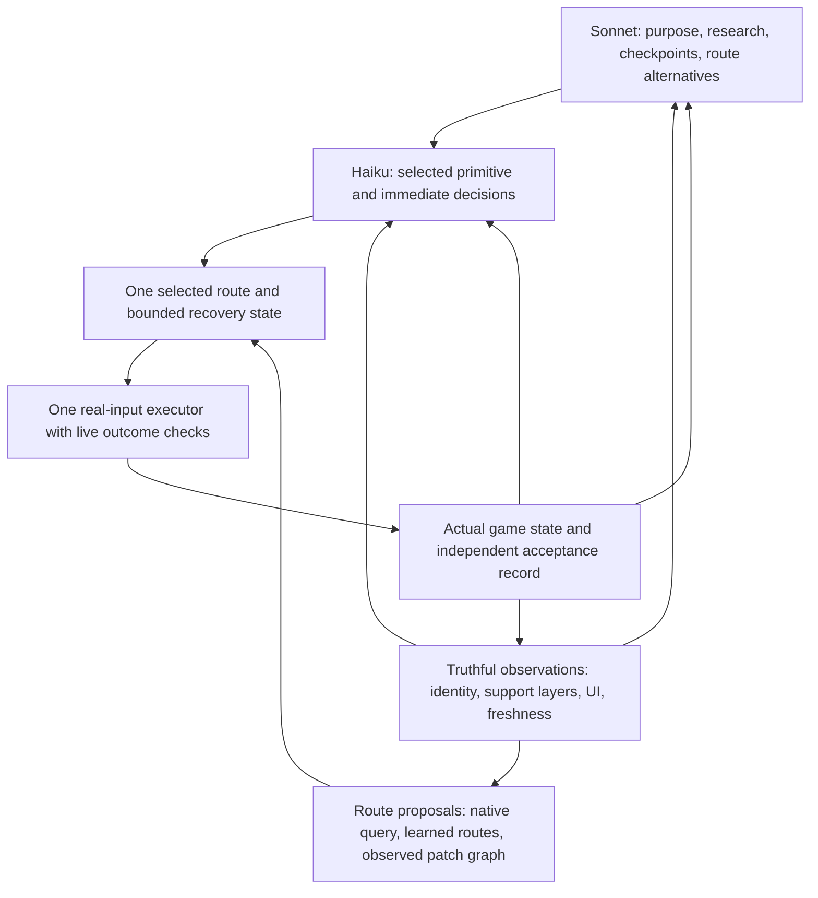

# Independent reset review: autonomous Dragonwilds companion

**Reviewer:** GPT-6 Astra, independent review requested by Luis, 2026-10-29.  
**Authority:** analysis and this report only. The development Goal remains **PAUSED**.  
**Binding priority:** [Accepted steer](../design/autonomy-plan.md), [original goal](../GOAL.md), [targets and frozen decision rules](../goal_targets.json), and [principles](../design/PRINCIPLES.md).

## 1. Executive verdict

The requested companion has not been delivered. The immediate temple walking acceptance remains **0/3**; no fresh evidence establishes the original M1–M6 goal. The latest published movement implementation failed a developer-driven public `go_to` after **23.468 seconds**. Its pending successor has useful simulated regression evidence, but no completed full gate, no deployment and no live result. A review, a green offline gate, a stationary collision query or a commit is not a gameplay gain.

I recommend continuing the original goal **after Luis explicitly resumes it**, while substantially changing the navigation implementation strategy and the experiment loop. I do **not** recommend abandoning the real client, replacing Sonnet/Haiku, importing a general agent framework, or undertaking a whole-system rewrite. The working foundation is valuable: real input and UI paths, native observations, an ownership arbiter, world-separated learning, a persistent Director, and independent outcome predicates. The failure is that these parts do not yet form a coherent, measured end-to-end control system.

The strongest findings are:

1. **Route selection, execution and recovery still disagree about the route being followed.** The live trace shows a remembered ascending route giving way to a lower native target. Current source retains multiple competing paths and has recovery that discards one authority while leaving another available. The exact live trigger for the first discard is not recorded. The pending progress fix addresses a real control-flow defect in simulation; it has not established that this defect caused the live failure.
2. **The current discovery substrate is structurally insufficient for a class of unfamiliar routes.** Local A* can detour inside its window, but an out-of-window prefix must end closer to the destination. A route that must first travel farther away beyond that window cannot be discovered by repeatedly applying that rule. Remembered player routes fill this gap only where someone already supplied the topology. The pending partial-path observation change does not remove this limitation.
3. **The planner interface has measurable defects before model reasoning can be fairly judged.** In the actual complete-agent run a709, Sonnet requested `look` four times and `lodestones` four times; the research dispatcher rejected those names. Four malformed Sonnet JSON outputs ended at exactly **2,048 completion tokens**, cut off mid-object. The live launcher sets Sonnet to 2,048, even though a different convenience factory specifies 16,000. Provider finish reasons are discarded, so truncation is strongly supported rather than conclusively recorded. Repeated generic JSON repair was not a useful diagnosis.
4. **Truthful information exists unevenly and is lost or weakened at several boundaries.** Native floor/capsule data and action-result detail are improving. But object memory merges nearby same-class objects without Z or durable identity; prompt digests group same-name targets; external inventory read failure can appear as an empty inventory; the Director cannot make all useful read-only body queries; and no live trace yet proves the latest terrain failure packet reaches both models and changes the plan.
5. **The engineering loop repeatedly closed local implementation questions without closing the user outcome.** Real regressions were repaired, but the controlling experiment was often deferred until after several releases, probes and reviews. The project has optimized candidate correctness more effectively than accepted live behavior. Root owns this failure of integration and experiment selection; the evidence does not support blaming Haiku alone.

The immediate next action after resume should be a **single controlled replay that identifies why the selected ramp route is discarded**, using transition-level telemetry and the ordinary public movement tool. In parallel, a bounded owner can repair and verify the actual model request contract. Then make one coherent walking change, validate it through real controls, and promptly run the complete agent. Do not first launch another broad battery of stationary scans or train another temple route.

For generality, the next architectural increment should be a **bounded, persistent graph of observed walkable patches and connections**, with unknown space explicitly represented and away-first frontier choices exposed to the model. Reuse the current native sensing and local search where they work. Replace the competing route orchestration and the assumption that every local prefix must approach the final goal. Do not add a temple script.

This report establishes no new gameplay success. It was produced without tests, game/process operations, model API calls, memory changes, source edits, deployment, commits or delegation. The report itself is the only file written.

## 2. Scope, evidence standard and verified baseline

I inspected the brief, Accepted steer, original/recovered goal, target definitions, architecture and recovery records, principles, frozen judge paths, all eight earlier reviews named in the brief, associated design notes, relevant current source and Git diffs/history, and recorded native/developer/complete-agent evidence. Large chronology documents were used to reconstruct relevant checkpoints, not treated as a substitute for source or raw results. I searched repository research first, then searched and opened primary external documentation/source; the research record is in section 9.

Paths in this report use:

- **F:** `C:/Users/Administrator/.codex/worktrees/feedback-loop/gameserver` — source worktree.
- **R:** `C:/gameserver` — deployed runtime and private evidence.
- Source line references identify the inspected working copy; pending additions shift some lines from published HEAD. Functions and named branches are the more durable locator.

Evidence grades used throughout:

| Grade | What it establishes | What it does not establish |
|---|---|---|
| Static source/history | A code path, configuration or structural limitation exists | That the path caused a particular live incident |
| Simulated regression | Behavior under the supplied fake observations/scheduler | Real physics, scheduling, native API compatibility or autonomy |
| Stationary native probe | A native observation at a particular pose/context | Successful control, a complete path or safe general traversal |
| Developer real control | The real character performed the recorded action under disclosed direction/setup | Unassisted route selection or complete-agent acceptance |
| Complete Sonnet/Haiku run | What this full system actually did with its recorded inputs | Completion unless independently observed criteria were satisfied |
| Frozen scored measurement | A current valid case against the unchanged judge | Other milestones, other hashes or Luis's final sign-off |

**Published baseline.** F HEAD is `8b49235`, also the last recorded published deployment. The latest successful full gate is `R/logs/recovery/adg-g-a742/check-all.log`: **1,279 passed, one skipped in 500.70 seconds; `CHECK_ALL: GREEN`**. `tools/check_all.ps1` runs the pytest suite, including its Lua wrappers. It is not an autonomous gameplay acceptance run. Synthetic timing output inside that suite is not measured live latency.

**Pending candidate.** The inspected diff changes `client_mod/scripts/move.lua` by 92 lines and its Lua test file by 217 lines, plus documentation. Its important additions are partial-native observation selection, early physical-waypoint progress credit, narrower no-progress recovery, and a guarded-stall diagnostic record. `R/logs/recovery/por-g-a760/check-all.log` ends at 16%; the handoff records the gate being stopped on Luis's pause and no publication manifest. The candidate must remain **unpublished and unvalidated live** in every report.

**Operational state.** The final PAUSED entry in `R/logs/recovery/ACTIVE-HANDOFF.txt` is authoritative. It records client off, retained server/Steam/oracle and no active game brain. I did not inspect or operate those processes. An earlier ACTIVE entry does not authorize work. Historical shared API spend was $1.1906 over 76 calls on October 29, not a new allowance calculation; future work must re-read it.

**Original goal.** `evals/bench/hashes.py:JUDGE_PATHS` includes the target/goal files, benchmark scoring code, `brain/predicates.py`, spell denominators, native benchmark probe, observation/voice scorers and fixtures. These remain frozen. New diagnostic observations must not silently alter their semantics, thresholds, cases or validity rules. Temple readiness is an immediate prerequisite and additional acceptance requirement, not a replacement for M1–M6.

## 3. Capability and evidence matrix

| Capability or claim | Strongest inspected evidence | Verified conclusion and remaining gap |
|---|---|---|
| Physical ramp ascent | Friend-trial observed developer input; a716 direct controls; a735 same-pose query then ordinary input | The player can walk relevant ramp surfaces. This falsifies “the character cannot physically get up there.” It does not prove the production planner can select and retain the route. |
| Walking out beyond 200 m and returning | `R/logs/recovery/wt-trial-a716/direct-outbound-healthy.json`, `direct-home-final-trace.json`, related driver scripts | Developer controls reached beyond 200 m and returned alive. Nutrition setup was assisted; several legs used `nav=false, local_plan=false`. Endpoint `[258.64,1878.83,-27.39]` is over 200 m from the recorded spawn/lodestone references. This is a physical feasibility diagnostic only. |
| Native navmesh covers player ramp | Player-grounding recorded native queries and tight projection controls | Default/no-explicit-mesh routes repeatedly end low and partial; a manually walkable upper route is not represented by the tested query. Alternate mesh selection did not supply a general solution. Exact bake/filter/agent cause is not proved. |
| Production taught route replay | `R/logs/recovery/rp-trial-a719/normal-ramp-doorway-a747.json`, samples and client-log interval | Published `8b49235` follows several ascending memory points, then chooses a lower native/local route and fails after 23.468 s with `walking terrain: sensor_unavailable`. No end-to-end pass. |
| Ground chord refinement | a735 actual query/input; a737 spacing controls; a738 midpoint; a740 stationary candidate replay | A straight capsule chord can block while native walking succeeds; freshly supported subsegments can be a better geometric approximation. Stationary clear does not prove entry admission, traversal or general StepUp equivalence. a740's recorded health was 1, further excluding it as a gameplay success. |
| Partial path observation | Current pending diff and real-module fake-world regressions | The source now permits local observation despite a partial native route and preserves in-flight observation against a late incomplete reply. No live evidence yet; the discovery policy remains locally goal-improving. |
| Waypoint progress accounting | Pending regression reproduces novel positions reaching 2,205 cm while `prog_pos` remained at zero | A genuine implementation defect was isolated in simulation: early returns could lose credited progress and trigger unrelated recovery. Pending repair is credible but not established as a747's cause. |
| Complete walking job | `R/logs/recovery/rfp-trial-a709/full-agent-result.json` plus actual input/output/body JSONL | 18 Sonnet and six Haiku outputs; 43 body requests; task `3fccd0b3` remains active. Movement stays roughly 19 m from the task's recorded lodestone reference, nowhere near 200 m. No exception field is not a pass. |
| Planning/research integration | a709 actual tool outputs and model-input histories; `brain/director.py`, `brain/run_live.py`, `brain/llm.py` | Eight rejected planner research calls; four JSON outputs cut at the live 2,048-token limit. Current source retains the relevant interface/configuration defects. |
| Correct compound completion | Earlier compound-completion record; current `ordered_steps` source and a709 resumed task | Earlier global near-at-home false completion motivated a useful repair. The resumed task still carries historical completed return state and obsolete completion/advisory baggage. A new episode is required; preserving memory does not require reusing a contaminated evaluation task. |
| Object/interaction truth | Current map memory, situation digest, native focus and inventory/UI code; earlier interaction review | Exact native detector/menu-owner checks and real UI transfer handlers are worth keeping. Persistent identity, candidate differentiation and unknown-vs-empty semantics remain incomplete. |
| Independent food/water replenishment | Historical Haiku-only water chain; survival review; a703 and idle diagnostics | Some real consumption, collection, building and processing paths work with supplied starting resources. No repeated from-scratch Sonnet/Haiku replenishment/resume acceptance. Idle developer starvation is an operational failure, not evidence that an inactive model chose badly. |
| Sustained exploration | Friend trial and current `skills.lua:start_explore` | Attempts and lexical matches occur, but repeated points, a KillZ death, failed semantic searches and lost route selection prevent accepted exploration. Counting legs is not counting successful traversal. |
| Gather/return/deposit, M1–M6 | Goal records, historical partial evidence, current status notes | Existing components and historical cases are useful starting points. I found no new current-hash evidence closing these milestones; none should be declared met from this review. |

### Important evidence paths

- Friend trial: `R/logs/recovery/friend-trial-20261028/live-observations.jsonl`, `OBSERVER-INSTRUCTIONS.txt`, `route-compare-20261028-230635/positions.jsonl` and related comparison records.
- Complete agent: `R/logs/recovery/rfp-trial-a709/{full-agent.py,full-agent-result.json,actual-model-inputs.jsonl,actual-model-outputs.jsonl,actual-body-requests.jsonl,actual-body-results.jsonl}`.
- Physical controls: `R/logs/recovery/wt-trial-a716/`, especially `direct-ramp.lua`, `operator-leg.lua`, `direct-outbound-healthy.json`, `direct-home-final-trace.json`.
- Collision/execution discriminators: `R/logs/recovery/rp-trial-a719/actual-query-then-input-a735.json`, the a737/a738/a740 records, and `normal-ramp-doorway-a747*`.
- Pending design: [partial-route-observation](../design/partial-route-observation.md); prior boundary analyses include [player-grounding-native-controls](2026-10-29-player-grounding-native-controls.md), [unfamiliar-route-selection-gap](2026-10-29-unfamiliar-route-selection-gap.md) and [adaptive-ground-chords](../design/adaptive-ground-chords.md).

Private traces remain outside Git. This report cites them rather than copying raw logs, world identifiers beyond the necessary DEV provenance, or secret material.

## 4. What actually happened in the strongest failure traces

### 4.1 The published a747 failure is a route-continuity failure with an unrecorded first trigger

The developer gave the ordinary public `go_to` target `[85.52,1855.15,-31.39]` with existing taught memories disclosed. The character started near `[64.55,1877.38,-35.43]`. The log records a 16-point forward observed route. It ascended through memory points near:

`[66.39,1875.20,-34.72] -> [68.15,1873.35,-33.79] -> [69.96,1871.45,-32.66] -> [71.72,1869.60,-31.47]`.

At 19:01:40.669 UTC it was near `[71.865,1869.447,-31.449]`, about 21 cm beyond that last point horizontally. At 19:01:41.937 it was near `[71.766,1869.552,-31.461]`, about 6.7 cm from it. The next sparse observation shows source `nav`, aim near `[66.24,1866.88,-34.90]`, while stale memory index/source fields remain. A local-plan log targets that lower point, labels its initiation `water_ahead`, and records 716 traces with about 1.75 seconds standing. The command later fails with `sensor_unavailable`, ending low and about 21 m horizontally from the requested destination.

This establishes successful partial ascent followed by an inappropriate route transition and terminal sensor failure. It does **not** establish which of the following first happened: real physical stall, false active-time stall, waypoint overshoot/chatter, source invalidation, or a different recovery branch. The sparse samples and missing transition reason cannot decide that. The retained memory fields match the static guarded-stall branch, but that is a hypothesis to instrument, not a causal verdict.

The pending candidate's fake-world lost-progress defect may be relevant, but the fake world reached a different failure boundary. “The regression now passes” is not evidence that a747 is repaired. Likewise, `water_ahead` is a recovery label, not proof the upper ramp was flooded. It may describe sensing along the lower aim already selected after the first failure.

### 4.2 a735 proves a geometric proxy was too conservative, not that all native walking is safe

In a735, a fresh Player capsule sweep from actual position around `[70.607,1870.770,-32.165]` toward `[71.72,1869.60,-31.47]` reports a blocking hit about 34.9 cm along the chord, with upward-facing normal. Ordinary real input from the same pose, after query cleanup, reaches approximately `[71.76,1869.56,-31.46]`, grounded with health 100. There is no jump or location write in that discriminator.

That is unusually useful evidence. It disproves equating a blocked straight capsule-centre chord with an impossible floor-following movement. The a737 spacing study and a738 supported midpoint explain why shorter supported segments may pass. It does not justify shrinking the capsule, accepting all upward normals, ignoring a failed query, or declaring an arbitrary gap safe. It also does not prove the current sampler accurately models every ledge, side clearance or stair. Keep the raw blocked result and distinguish geometric candidate admission from actual native execution.

### 4.3 a709 shows a complete agent spending much of its bounded attempt at interface boundaries

The captured output interval is **14:59:27.471711–15:02:32.693863 UTC**, with 18 planner and six controller responses. There are 43 recorded body requests: 33 `get_state`, three `spells`, two `interact`, two `explore`, one each of `ping`, `say` and `go_to`. These counts describe this run only; they do not establish a whole-day productivity percentage.

The Director's calls include five `map_memory`, four `lodestones`, four `look`, three `recall` and one `lookup`. The `look` and `lodestones` names are rejected as nonexistent research tools. Source still lists only `craft_plan`, `recipes`, `stations` and `buildables` as proxied body reads. The Director prompt includes the full body capability manifest for plans, making separation between “can plan this action” and “can call this research tool now” especially important.

The four malformed planner texts have recorded completion usage exactly 2,048 and visibly end mid-field/object. `brain/run_live.py:make_llms` creates the planner with `max_tokens=2048`; the wrapper explicitly calls this function. `brain/llm.py:planner_llm` having a 16,000 default elsewhere is irrelevant to this route. `LLMResponse` retains usage/message but not provider finish reason. The next correct experiment is to capture the actual serialized limit and finish reason, then correct output budgeting/formatting; increasing repair attempts would repeat the same ceiling.

The retrieved wiki material identifies the Wise Old Man but does not establish an exit-opening mechanism. Sonnet marks the unlock theory uncertain and nevertheless attempts NPC interaction. The two interactions fail differently: no verified change after use, then path blocked. The two `explore` calls stop on an Ash Logs lexical candidate. The lexical false-match issue has since been repaired in source, so that historical symptom must not be represented as unchanged current code.

The last `go_to` failure completes at **15:02:41.618 UTC**, after the last captured model response and after the last relevant model input. No current terrain packet appears in those captured model messages, but that does **not** prove a broken delivery path: this terminal result was censored by the end of the bounded run. A future trace must include the *next* Director and Controller requests before judging delivery or plan revision.

Finally, this was a resumed task. Its persisted return step was already marked done while outbound remained unmet, and its completion state included an elapsed-time condition. Later plans repeatedly collide with that history. Preserve the failed task as evidence; create a new task episode through supported board operations for acceptance. Do not erase learned world state or silently repair old checkpoint history and call the result a fresh success.

## 5. Root-cause and architecture analysis

### 5.1 Keep the two-speed architecture; replace competing navigation authority

The model should choose purpose, destinations, search alternatives, task sequencing and responses to uncertainty. Deterministic code should execute a chosen primitive, manage its physical preconditions and report observed effects. Real client input, native UI handlers, the arbiter and bounded frame-level motion belong in this design.

The problem is not simply “too many lines.” It is that route authority is represented by interdependent flags and independent path tables: native path, local path, memory path, leader crumbs, traversal links, backtracking and obstacle recovery. In the inspected `move.lua`:

- `far_goal()` around line 2824 first returns a native waypoint when `nav_required` and `st.path` exist, before considering the memory route. A repair can therefore target a path different from the one that supplied the current intent.
- The guarded-stall branch around 3020 clears local/memory authority but leaves native path state. Some memory index/source fields also remain. A lower native partial route can reappear without an explicit, model-visible explanation of that choice.
- `nav_force` has assignments but no consuming read in this module. Setting a flag with no effect is misleading evidence of requested replanning.
- A complete native route is preferred, but “complete in this NPC-oriented query” still needs a player-valid connector, endpoint and execution contract. Partial native paths should be candidates toward known connected space, not compulsory authorities.
- Local/memory binding checks are impressively defensive about pawn, controller, generation, ownership, world and life sequence. Preserve that safety. Their repetition across many branches is a sign that authority should become one explicit state object, rather than a reason to remove ownership checks.

**Recommended invariant:** one `selected_route` at a time, with original goal, source/provenance, ordered segments, typed coordinate/support conventions, endpoint completeness, generation/life/world/owner binding, validity evidence and progress state. Native routing, observed local geometry and learned routes propose candidates; they do not steer independently. A recovery either repairs/replaces that selected route for the same goal, or terminates/returns bounded alternatives with a specific reason. It must not silently resurrect an inactive path.

This can be introduced around the existing backend and executor, then migrated branch by branch. Do not preserve two live controllers indefinitely behind flags. Once the new executor passes the controls, delete the old branch for that mode. Begin with ordinary walking; follow and typed traversal can migrate using the same contract.

### 5.2 Physical execution needs a coherent motion contract, not an ever larger list of guards

The source has repaired several genuine issues: floor height resolution, scan expiry anchored to completion, active input rather than guard holds for stall accounting, and capsule chord refinement. These repairs improve candidate truth. They do not yet establish a viable closed-loop controller at actual game cadence.

Current values include a 10 cm reach radius for guarded waypoint advancement, a one-second/50 cm active stall window, a five-second no-progress threshold, a roughly one-metre walking horizon and a 0.35-second completed-scan lifetime. Those values interact with input speed, inertia, frame stalls, query work and target changes. The a747 overshoot and return near waypoint five make reach/control interaction a serious hypothesis. Raising tolerances globally is not a justified repair, because it may skip the only valid connector or a floor transition.

The executor should maintain progress **along the selected safe corridor**, not only distance to a point or final goal. Waypoint advancement should be based on measured segment progress and same-support/corridor conditions; corner approach may require reduced real input magnitude. Any such change needs measured braking/drift and actual input/velocity evidence. Do not write movement-speed/physics properties to make a test pass.

Separate three clocks:

1. Wall/monotonic command deadline, including planning and sensor waits.
2. Actual admitted-input exposure, tied to observed game frames, for physical stall detection.
3. Novel task/route progress, which excludes looped motion and route replacement.

A synchronous native callback can consume CPU time without advancing the frame-latched game clock. A reported zero-duration search can therefore be misleading. Record both game/frame time and external monotonic timing for diagnostics; do not add their values or reset deadlines on replans. A valid motion horizon must cover current motion and stopping distance under measured cadence. If sensing cannot refresh it cheaply enough, reduce commanded motion or redesign query scheduling; do not relabel stale observations as current.

The existing guarded path is also not the only movement path. Pure native steering and some link/jump states bypass parts of the walking guard. Around `move.lua:1864`, rising native waypoints can be assigned `link=true` from height and XY spacing alone; later code treats that as a jump link. That is not native typed off-mesh metadata. A slope can satisfy the same condition. It is an unresolved source risk, not a demonstrated cause of a747. Unknown traversal type should trigger observation/model-visible uncertainty, not automatic jump authority.

### 5.3 A persistent topology is needed for generic unfamiliar-route discovery

`localplan.lua:LP:plan` searches sampled nodes inside the local window. If the target lies outside, it chooses the reachable node closest by its goal heuristic. It rejects insufficient improvement (`no_progress_possible` or `unreachable_in_window`). The movement admission branch additionally requires a distant-goal prefix to improve XY goal distance by more than `progress_cm` (150 cm).

This is not the same as saying A* cannot detour: it **can** take an initially worse step when a better endpoint is visible within its window. The structural failure is an obstacle whose route initially recedes farther than the sampled window. For example, a long wall may require walking away from a destination to reach the only opening. Every reachable window endpoint can be farther away even though an eventual valid route exists. The present prefix policy rejects that useful exploration. Enlarging one window merely moves the counterexample outward and increases native query cost.

The current local sample is also a limited observation model: approximately one-metre cells, bounded layers from selected downward traces, merges close surfaces, local self-region handling and lazy clearance checks. It is not a complete 3D terrain map. Narrow openings, stacked surfaces or an overhang can be missed. The observed patch is discarded after route construction; negative/unknown geometry and its connectivity do not become a persistent discovered map. `navmem` mainly preserves experienced routes, not the geometry that would reveal an unseen route.

The generic `explore` in `skills.lua:1759–1854` selects among eight XY directions, retains the current Z for each distant target, and scores least-visited cells/farther distance. It does not select connected observed frontiers. A lexical object match can stop it without satisfying a geometric description. This tool remains useful as a bounded search primitive only if its claims are honest; it is not a terrain discovery solution.

**Recommended representation:** sparse local support patches with explicit vertical layers, connected by locally verified walking edges; maintain a bounded topological graph as the observation window moves. Store observed-free, blocked and unknown separately, with source, age, world/build and failure context. A frontier is a reachable edge of known space adjacent to unknown space, not a guessed distant XYZ. Expose a small set of connected candidate frontiers, costs/risks and what they might reveal to the model. The model chooses which frontier serves its job; the body supplies the route and validates each executed segment.

This needs no SLAM initially: authoritative game positions already exist. It needs no dense world reconstruction or GPU. Start by retaining and connecting the current sampler's useful output. Add adaptive local resolution or additional support queries only where a paired native observation demonstrates that the existing sampler misses a usable connector. A scalar height map cannot represent two walkable floors at the same XY; separate layers and connector evidence are mandatory.

Learned routes remain useful proposals. Preserve discontinuities when sampling: removing airborne/gap samples and joining the remaining points can invent a walking edge. Preserve provenance separately from actor identity: a route recorded from the bot's own body while the developer drives it is still operator-taught, even if its current source tag says `self`. Existing memories must be retained, with uncertain legacy provenance explicitly marked. Fresh discovery must use held-out geometry that those memories do not encode.

### 5.4 Perception must distinguish objects, surfaces and actionable interfaces

The current census is a replicated/loaded-actor observation, with radius and category limits. It is not equivalent to visual visibility, a full world inventory, or a geometric exit detector. A failed `look("ramp")` does not establish that no ramp exists. A missing actor may be unloaded, filtered, capped, out of range or inaccessible to that sensor.

`brain/map_memory.py:_key` around line 93 identifies a sighting by kind, class/name and a rounded two-metre XY cell. It omits Z and actor identity. Nearby identical chests and stacked objects can overwrite one another. Their IDs then change under one apparent memory entry, and a newer timestamp can falsely refresh the identity. This is a static defect directly relevant to reliable chest/station use, even though the supplied a747 trace did not exercise it.

Use a world-scoped persistent game identifier where runtime evidence shows it is stable. A transient UObject/address/short name is a session identity, not a promise of persistence across reloads. Where durable IDs are unavailable, use a clearly uncertain spatial signature including Z/support layer and class, retain multiple hypotheses, and reacquire the live actor before action. Migrate by preserving old records and provenance, never clearing them.

The situation digest groups by display name, keeping the nearest representative ID and increasing count. Its 18-line budget can also drop optional usable/station context. This is acceptable for a general overview only if a targeted read can recover individual candidates, position/elevation, owner, interaction point, read freshness and unknowns. For an active chest or station task, preserve the chosen candidate and nearby ambiguous alternatives rather than repeatedly presenting an undifferentiated name.

Target actor origin, interaction point, collision geometry and valid standing pose are distinct. The model should choose an object from truthful candidates. Deterministic interaction should find/validate an approach pose, establish native detector focus on that exact actor, open the expected UI owner, perform the existing real UI action, verify deltas and close the owned panel. It must report separately whether the requested operation succeeded and whether cleanup succeeded.

Existing exact detector checks and inventory UI handlers are strong assets. `inventory.lua:external_rows`, however, returns an empty structure on invalid/paused/failed reads, and some callers interpret that as an empty container. Extend the richer known/partial/unknown semantics already used for personal inventory. A failed read is neither empty nor proof that an item vanished. Crafting's separate approach state machine should converge on the same approach/focus lifecycle after a demonstrated shared case; rewriting all menus first would be wasteful.

### 5.5 The model boundary must be fixed before a model-capability verdict

There are three separate contracts:

- **Research calls Sonnet may make now.** These must match actual advertised callable schemas and a safe dispatcher. Useful read-only scene/lodestone/target queries can use the existing main-thread `BodyProxy`; do not call native game APIs from the planning worker.
- **Actions Sonnet may place in a plan for Haiku.** These need complete argument schemas and truthful limitations, but should not look like additional immediately callable research functions.
- **The structured decision returned to the board.** Its size, schema, truncation/refusal handling, semantic validation and completion rules must match the real launcher/provider path.

The current result-summary repair in `brain/director.py` retains bounded primitive action data, prioritizes failures and carries it through failed-attempt snapshots. Earlier “Director always drops all useful tool detail” is therefore stale as a blanket claim. Nonetheless, actual-request evidence remains required. Capture the serialized tools/configuration as well as messages, and the provider finish reason as well as text/usage. The a709 wrapper records messages but not the final tools payload or output settings, preventing a complete audit of what the provider was offered.

Provider-enforced structured output is worth adapting after verifying the installed LiteLLM path. It does not solve semantically wrong plans, insufficient output budget, failure to act, or misleading completion criteria. Keep local schema and semantic validation. Bound repairs, reserve enough output for the real decision, and distinguish truncation from bad JSON instead of feeding both into an identical retry. Do not copy a large maximum from a generic coding guide; measure actual decision size and thinking overhead within the $10/day cap.

Knowledge lookup is currently local generated game data plus a SQLite FTS wiki mirror, with short snippets. That is a legitimate fast research substrate, but not general on-demand web research. It needs truthful coverage/age/source labels and a way to read the relevant source section when the excerpt is insufficient. If a necessary page is absent, add a bounded retrieval/cache path rather than guessing. The model may infer a hypothesis; it must not report it as a verified mechanic. New recipes/crops should change data and plans, not require a new workflow in code.

### 5.6 Task persistence and survival need actual outcome accounting

The ordered-checkpoint repair is directionally correct. The current `near` distance includes Z through `brain/geom.py`; it is not a planar-distance bug. But a three-dimensional radius still does not prove the correct connected floor. `moved` compares the current position with a step baseline; it is not automatically “200 m from the original lodestone.” Acceptance must independently retain the starting landmark and ordered visit evidence. Do not alter frozen predicates to make this case easy.

For sustained work, persist the job, current checkpoint, verified resources/deposits and reason for interruption. Replanning may change the route or means, but must not discard an unmet outbound requirement or count a previously true return condition as a completed round trip. A typed terminal result must distinguish completed, bounded failure, interrupted, waiting on an actual external dependency, and still active at the experiment cutoff.

Carried-item reflex consumption is useful fast protection. It is not a replenishment policy. The model needs current needs, carried usable reserve, attainable acquisition/processing alternatives, travel/time cost and a persistent interrupted task to resume. Early planning should acquire and replenish reserves before the reflex reaches an emergency. Do not hard-code a berry/water/campfire script or disguise begging as self-sufficiency. If navigation makes every supply inaccessible, report that dependency explicitly.

Operational survival is separate. Leaving a healthy character idle during analysis until dehydration kills it is an avoidable scheduling failure when no brain is active. Future diagnostics need declared reserves and a bounded active window, followed by a clean client-off interval when useful gameplay is not running. Such supplied reserves remain fixture assistance and cannot be counted as autonomous acquisition.

## 6. Disposition of earlier reviews and repairs

| Earlier finding or repair | Current disposition | What should happen next |
|---|---|---|
| NPC navmesh treated as player authority | Partially addressed through native/player grounding and memory/local proposals; competing authority remains | Keep the query as a proposal source; unify selected-route execution and record projection/partial truth. |
| Centre/feet/support confusion | Several explicit conversions and floor-resolution fixes exist | Retain typed conventions; validate each boundary and stacked-floor controls instead of claiming a universal axis error. |
| Completed scans expired before useful input | Published completion-window repair exists | Measure actual admissible-input duty cycle and query cadence in the failing replay. |
| Guard waits counted as physical stall | Published active-input accounting exists | Measure frame/monotonic exposure and waypoint transition; do not assume the remaining stall is the same old defect. |
| Straight chord rejects walkable curved support | Strong native discriminator; adaptive candidate published | Keep bounded refinement as a hypothesis backed by motion controls; do not extrapolate stationary clear to end-to-end walking. |
| Taught routes excluded from useful fallback | Generic forward observed routes published | Preserve as labelled proposals; prove replay separately from discovery. |
| Partial native path suppresses local observation | Pending repair and useful fake-world regression | Include only in a coherent authority design; its existence does not answer away-first discovery. |
| Early-return progress credit lost | Newly isolated in pending candidate | Retain regression and fix concept; establish relevance through live source-transition evidence. |
| Planner loses rich action failure feedback | Bounded result-summary path now exists statically | Capture the next actual requests after a real terminal failure; do not repeat the stale blanket accusation. |
| Lexical match pretends full semantic success | Published wording/matching correction | Verify known false positives in actual model input and keep geometric exits separate from lexical objects. |
| Object memory conflates same-name/stacked targets | Still present | Repair identity/read-state contract before claiming reliable deposit/station outcomes. |
| Headless UI introspection or vision might help | Useful hypotheses, not verified capabilities | Measure one native semantic gap, then one bounded runtime compatibility probe. No broad UI/framework replacement now. |
| Local wiki lookup insufficient | Coverage/section access still limited | Improve factual retrieval only for a demonstrated question; retain sources and unknowns. |
| Self-care means consuming supplied food | Remains unproved as independent replenishment | Full-agent repeated acquire/process/consume/resume job after movement readiness. |

The earlier reviews were not worthless. They exposed real contract problems. Their recommendations were diluted when individual fixes were successively treated as nearly finishing movement, while no single coherent controller and discovery policy was forced to satisfy the full negative controls and live task.

## 7. Follow the information all the way into the model request

The acceptance of an observability change must cover this whole chain:

`native observation -> typed body state/result -> bridge -> task/episode history -> bounded context -> serialized model request -> chosen action -> observed effect`.

| Boundary | What exists now | Required proof |
|---|---|---|
| World to body | Native position/vitals, census, detector focus, floor/capsule observations and UI-specific reads | Source, units, identity, sample time, coverage and unknown fields on the failing real case; no inferred “clear” on absent data. |
| Body to movement result | Route feedback and terrain details, with ownership/freshness checks | A specific terminal primitive reason and original/selected goal, not only `verification_failed`; distinguish hold, obstruction, unsupported floor, deadline and invalid owner. |
| Result to Director | `_result_summaries`, `_last_results`, failed-attempt snapshot/detail propagation | The *actual next request* contains the bounded relevant packet, including enough data to choose another action. Presence in a Python object or debug log is insufficient. |
| State to Controller | Situation digest plus tool/action context | The exact target identity and relevant failure survive grouping, line caps and history truncation. Verify the actual request, not a prompt unit test alone. |
| Director research to body reads | Immutable snapshot research plus restricted `BodyProxy` | Advertised callable names equal dispatcher names; safe queued reads run on the existing owner/main-thread path. No direct worker-thread native access. |
| Knowledge to plan | Catalog/FTS snippets, recall and persistent facts | Relevant fact supported by a source section; missing coverage stays unknown; model does not turn an NPC biography into a verified exit mechanic. |
| Model to executor | Schemas and Pydantic/semantic plan checks | Actual token/output configuration, finish reason, valid bounded plan and correct argument units. No silent coercion into a different chosen action. |
| Executor to completion | Native outcomes and board predicates | Ordered observed milestones against the retained original objective; no substitution of a nearby intermediate point or pre-existing true condition. |

For precise reproduction, the four malformed outputs are in `R/logs/recovery/rfp-trial-a709/actual-model-outputs.jsonl`:

| JSONL line | UTC timestamp | Recorded completion tokens | Observed ending |
|---|---|---:|---|
| 8 | 2026-10-29 15:00:15.671713 | 2,048 | Mid-object after a `loops` field begins |
| 12 | 2026-10-29 15:00:49.151108 | 2,048 | Mid nested success predicate |
| 18 | 2026-10-29 15:01:37.611721 | 2,048 | Mid workaround string |
| 19 | 2026-10-29 15:01:47.950202 | 2,048 | Mid workaround string |

All four fail parsing under the current first-`{`/last-`}` extraction strategy. The captured usage, visible endings, actual launcher and wrapper jointly support output-budget truncation. The missing finish reason prevents stronger attribution. This is separate from the rejected research calls: even a perfectly formatted plan can waste its research rounds if it requests names the dispatcher cannot serve. Both contracts must be repaired and measured.

## 8. Architecture decision and alternatives

### Recommended minimal coherent direction



The graph is an architecture proposal, not a claim that all these observations currently exist. It deliberately preserves one live owner. Deterministic routing within a model-chosen destination is a physical primitive; choosing the job, interpreting an “exit,” selecting a search frontier for its purpose, or replacing the player's objective remains model work.

The first walking change should be small in *conceptual scope*, not necessarily a tiny diff: one route authority, coherent progress/recovery and the exact motion correction the discriminator supports. The discovery increment then retains observed connectivity and permits model-selected away-first exploration. Identity/UI improvements form a separate coherent transaction contract. Model request repair is a separate bounded owner task. This gives three independently reviewable contracts rather than another collection of symptom-specific conditions in `move.lua`.

| Option | Strongest case | Why it is or is not the next choice |
|---|---|---|
| Keep patching the existing branch priority order | Lowest immediate diff; previous fixes expose real bugs | Use only to close a measured boundary inside a single coherent route contract. Stop accumulating independent authorities and retry flags. The current greedy discovery policy has a static counterexample. |
| Make native Recast/AI MoveTo authoritative | Mature global routing and corridor machinery | Tested coverage does not match the player's route, and direct control/API compatibility is unproved. Better query metadata and filters are useful; replacing real input with an NPC controller is not justified. |
| Increase local grid radius/resolution everywhere | May reveal one missing doorway or detour | Query cost grows quickly; still no arbitrary away-first exploration, persistent topology or correct multi-floor representation. Adaptive refinement is conditional on a measured sampling miss. |
| Recorded player routes as the general answer | Efficient, authentic experience reuse | Good for taught replay and later efficiency; cannot satisfy first-time discovery. Operator-driven bot routes must not be called unaided learning. |
| Persistent sparse layered patch graph plus current native queries | Uses authoritative positions and existing sensing; supports connected frontiers and remembered failures | Recommended. Native sensing/clearance cost and layer discrimination must be measured. Build the smallest graph needed; avoid a dense world map. |
| Full 3D reconstruction/SLAM/ROS navigation stack | Rich mapping and established algorithms | No localization problem has been demonstrated; the necessary data and runtime budget are not present. Adopt invariants, not the deployment stack. |
| Vision-first or a computer-use MCP | May reveal visual door/quest/UI information absent from current semantics | Conditional fallback only. Headless NullRHI has no usable rendered frame; actual Windows/game UI accessibility and rendering feasibility are unproved. Does not fix route authority or truncated JSON. |
| Switch the deployment models or add a third reasoning agent | Could improve planning on a truthful interface | Not supported as the first intervention and conflicts with the required Sonnet/Haiku acceptance. Diagnose with the required pair after fixing measured interface defects. Development-model success is not deployment-model acceptance. |

## 9. Research record: exact searches, primary sources and compatibility decisions

**Date:** 2026-10-29. Repository research preceded external search. The searches below were actually issued. Opened primary documents/source were then inspected; search snippets alone are not treated as API verification. Mutable `main`/`master` URLs below identify the inspected source location, not a pinned commit. Before copying code, record the actual commit/version and preserve its licence. This report copies no implementation.

### 9.1 Literal search queries

Movement, mapping and recovery:

- `site:dev.epicgames.com UCharacterMovementComponent MoveAlongFloor StepUp ComputeGroundMovementDelta 5.6`
- `site:recastnav.com dtPathCorridor movePosition optimizePathVisibility isValid`
- `site:docs.nav2.org route server local global planning progress checker path invalid recovery`
- `site:github.com leggedrobotics elevation_mapping multi layer grid_map terrain traversability`
- `site:docs.nav2.org route server consistent replanning path invalid`
- `frontier based exploration Yamauchi 1997 pdf robotics`
- `site:docs.nav2.org behavior trees NavigateToPoseWithConsistentReplanningAndIfPathBecomesInvalid`
- `site:github.com leggedrobotics elevation_mapping_cupy_core CUDA 12 license`

Embodied agents and recent work:

- `site:github.com/mindcraft-bots/mindcraft 2026 navigation goals self_prompter`
- `site:github.com/MineDojo/Voyager environment feedback automatic curriculum skill library`
- `embodied game agent navigation multi floor long horizon October 2026 Mine Odyssey`
- `semantic UI grounding accessibility visual fallback 2026 Tactile computer agents`

Headless/UI/provider integration:

- `site:dev.epicgames.com supporting screen readers Unreal Engine shipping accessibility widgets`
- `site:docs.ue4ss.com Lua UObject UFunction reflection K2 FindFloor`
- `site:platform.claude.com structured outputs JSON tool use tool_choice none`
- `site:github.com yliust Tactile license platform windows`

Some broad queries returned irrelevant or secondary material. Only the primary sources below informed the recommendations. Additional direct opens followed links/source paths from those results. The recent papers are leads and evidence of established patterns, not claims that their measured performance transfers to this game.

### 9.2 Unreal movement and UE4SS: reuse the real implementation through supported input

Epic's [MoveAlongFloor documentation, UE 5.5](https://dev.epicgames.com/documentation/unreal-engine/API/Runtime/Engine/GameFramework/UCharacterMovementComponent/MoveAlongFloor?application_version=5.5) describes floor-aware movement and adjustment across another walkable surface. [StepUp, UE 5.5](https://dev.epicgames.com/documentation/unreal-engine/API/Runtime/Engine/GameFramework/UCharacterMovementComponent/StepUp?application_version=5.5) separately describes step/slope behavior and `CanStepUp` gating. These explain why an arbitrary capsule-centre chord is not the same operation as player walking; the decisive game-specific evidence is a735.

**Decision: reuse native player movement through real input; adapt observation/validation.** The recorded runtime is UE 5.6.1, while these opened API pages are explicitly 5.5. Their C++ signatures are conceptual references, not verified callable Lua functions. The [UE4SS UObject documentation](https://docs.ue4ss.com/lua-api/classes/uobject.html) exposes reflected properties/UFunctions and `CallFunction`; it does not make every C++ method callable. Smallest compatibility test: one bounded read of the exact reflected member on the DEV pawn, then a known-safe input/control pair with observed pose/support. No binary patch, fabricated UFunction or direct position write. A Lua `pcall` does not contain a native deadlock.

### 9.3 Recast/Detour: adapt a corridor contract, do not assume polygon access

The primary [Detour path-corridor reference](https://recastnav.com/classdtPathCorridor.html) separates path construction, current position/target updates, corner extraction and validity. It explicitly handles deviations caused by imperfect locomotion, with local-query limits.

**Decision: adapt those invariants into one selected-route object.** Reuse the current native route query only as far as its real response supports. The present bridge does not expose a Detour polygon corridor or proven off-mesh connection types. Smallest compatibility test for a deeper native adapter: obtain nav-data identity, agent/filter properties, endpoint projections, complete/partial status and typed link metadata on one known flat path and one failing ramp query. If those fields are not reflected, report that limit; do not invent flags from waypoint height. No Recast library vendoring or navmesh rebake is justified now. Recast's licence must be checked at a pinned source version before code reuse; none is copied here.

### 9.4 Nav2 and OMPL: adapt separation of planning, validation, control and recovery

The inspected [Nav2 navigation behavior tree source](https://raw.githubusercontent.com/ros-navigation/navigation2/main/nav2_bt_navigator/behavior_trees/navigate_to_pose_w_replanning_and_recovery.xml) distinguishes path validation, planning, following and error-specific recovery. The inspected [collision-checker source](https://raw.githubusercontent.com/ros-navigation/navigation2/main/nav2_regulated_pure_pursuit_controller/src/collision_checker.cpp) relates checking to commanded motion and a bounded horizon. These are robotics implementations with different geometry/control assumptions; their reset, spin and backup actions are not automatically appropriate for this game.

**Decision: adapt lifecycle and motion-horizon concepts, not ROS packages or default timings.** Keep memory and failure provenance rather than copying costmap-clearing recovery. The collision source carries Apache-2.0 attribution; retain notices if any source is later adapted. Smallest compatibility test is the proposed source-transition/input-exposure replay, plus a same-layer corridor control. Runtime cost must be measured on the actual single client.

[OMPL's state/motion validation documentation](https://ompl.kavrakilab.org/stateValidation.html) makes the application's validity checker explicit and explains the cost/correctness tradeoff in discretizing a motion. **Decision: use that distinction in design, no OMPL dependency.** Importing a planner would not supply Dragonwilds support, collision or action semantics. The smallest useful test is a segment with clear endpoints but an invalid interior, paired with a curved supported segment that native walking traverses. Both must retain their actual physical verdict.

### 9.5 Frontier exploration and terrain maps: adapt representation, reject an unnecessary runtime stack

Yamauchi's primary [frontier exploration paper](https://www.cs.cmu.edu/~motionplanning/papers/sbp_papers/integrated2/yamauchi_frontier_explor.pdf) distinguishes open, occupied and unknown space and navigates to reachable boundaries of known space to acquire information. Its completeness discussion assumes ideal sensing/control; it is not a guarantee for this project.

**Decision: adapt the frontier concept to a layered support graph and let the model choose among truthful candidates.** No paper/code or licensed figures need copying. Smallest test: a held-out connected detour whose first useful frontier is farther from the final destination and beyond the old local window, with an inaccessible frontier as negative control. The graph must retain observations across window shifts without treating unknown edges as traversable.

The inspected [elevation_mapping_cupy_core README](https://raw.githubusercontent.com/leggedrobotics/elevation_mapping_cupy_core/main/README.md) is specifically a ROS-free core, so rejecting it merely as “requiring ROS” would be inaccurate. It still requires CUDA 12/CuPy, point-cloud inputs and its elevation/semantic map assumptions; its licence is MIT. The older full mapping project adds ROS integration.

**Decision: do not install it here.** Recorded hardware/headless constraints and current sparse native queries do not supply its intended environment. Semantic map layers are not automatically multiple traversable floors at one XY. Reuse the conceptual separation of measured terrain, confidence and traversability only. A future dense-map proposal would first need measured input density, CPU/GPU availability, layer support and frame/memory budget. None is established by this review.

### 9.6 Mineflayer, Mindcraft and Voyager: useful boundaries, incompatible game backends

The inspected [Mineflayer pathfinder movement source](https://raw.githubusercontent.com/PrismarineJS/mineflayer-pathfinder/master/lib/movements.js) generates different walking, climbing/dropping and parkour neighbors from collision/block data, with explicit capability/cost constraints. Its [licence](https://raw.githubusercontent.com/PrismarineJS/mineflayer-pathfinder/master/LICENSE) is MIT.

**Decision: adapt typed transition/capability separation; do not port block-specific logic.** Minecraft supplies a voxel/block model that this Unreal client does not. The smallest game-specific test is one observed walk connector and one true gap whose transition type cannot be confused. Unlocked jump/air abilities require separate native execution/landing evidence; height alone is insufficient.

Mindcraft's inspected [SelfPrompter source](https://raw.githubusercontent.com/mindcraft-bots/mindcraft/main/src/agent/self_prompter.js) has explicit active/paused/stopped state, interruption and bounded no-command behavior. Its [licence](https://raw.githubusercontent.com/mindcraft-bots/mindcraft/main/LICENSE) is MIT. **Decision: reuse the idea of an explicit persistent task lifecycle, not its command syntax or restart loop.** This project already has a stronger board/arbiter foundation. The smallest useful test is a self-care interruption that preserves and resumes the original checkpoint once, with no duplicate owner or silent job loss.

Voyager's inspected [orchestrator source](https://raw.githubusercontent.com/MineDojo/Voyager/main/voyager/voyager.py) feeds environment events and critique into retries and records successful skills. It also contains environment resets and game-setting commands. Its [licence](https://raw.githubusercontent.com/MineDojo/Voyager/main/LICENSE) is MIT.

**Decision: adapt observed-feedback/skill-provenance ideas only.** Do not import generated arbitrary game code, resets, grants or a model critic as the final judge. The smallest transfer test is that one real failed primitive reaches the next model request and produces a different evidence-based choice while independent outcomes remain authoritative. A skill is retained as successful only after actual game evidence, with prerequisites and provenance.

### 9.7 Recent embodied evaluation: Mine Odyssey, October 2026

The opened [Mine Odyssey paper, 2026-10-08](https://arxiv.org/html/2610.11328v1) and [primary repository README](https://raw.githubusercontent.com/hkust-nlp/MineOdyssey/main/README.md) describe ordered navigation through entrances, stairs and levels with independent position-based verification. The reference runtime uses screenshots and asynchronous action/observation; the published quickstart is Linux/Minecraft and includes software rendering.

**Decision: adapt experiment discipline, not its runtime or tasks.** Independent ordered visit records and complete failure artifacts are directly useful. Its Minecraft software-rendering option does not prove Unreal NullRHI can produce images on this Windows host. Its model rankings do not establish a reason to replace the required pair. The attempted top-level `LICENSE` open returned 404; code-reuse licensing is therefore unverified, and maps/dependencies retain separate terms. No code/assets are to be copied. The smallest compatibility transfer is an independent ordered record for the existing temple task, without changing its frozen/original criteria or exposing hidden route waypoints to the agent.

### 9.8 Recent UI grounding: Tactile, July 2026, and Unreal accessibility

The opened [Tactile paper, 2026-07-16](https://arxiv.org/html/2607.14443v1) proposes source-labelled semantic targets and observe/ground/act/verify, with OCR/visual fallback. The [repository](https://github.com/yliust/Tactile) currently emphasizes a macOS MCP implementation. Its [licence](https://raw.githubusercontent.com/yliust/Tactile/main/LICENSE) is **PolyForm Noncommercial 1.0.0**, not MIT.

**Decision: adapt the evidence/action contract concept, do not install or copy this MCP.** It cannot create missing Unreal semantics, and desktop results do not transfer automatically to a headless game. Smallest useful test: for one real station menu, compare native owner/selection/enabled-state observations with the action and inventory result. Only a demonstrated missing signal justifies a bounded accessibility or rendering probe.

Epic's opened [screen-reader documentation](https://dev.epicgames.com/documentation/en-us/unreal-engine/supporting-screen-readers-in-unreal-engine) is a current UE 5.8 page. It describes accessibility configuration and custom widget support, and says support may be compiled out. **Decision: investigate conditionally, not claim availability in the recorded 5.6.1 shipping build.** First inspect a single live DEV menu's exposed native widget/UI information; if insufficient, check whether the shipped build exposes an accessibility tree. Do not modify engine configuration or restart into rendering as an assumed fix. A future rendered probe must establish one capturable frame, game responsiveness and resource headroom before any vision integration.

### 9.9 Claude/LiteLLM output contracts: use supported structure, measure the actual launcher

The opened [Claude structured-output documentation](https://platform.claude.com/docs/en/build-with-claude/structured-outputs) distinguishes JSON output format from strict tool input validation and documents schema limitations. The [Sonnet 5.5 prompting guide](https://platform.claude.com/docs/en/build-with-claude/prompt-engineering/prompting-claude-sonnet-5-5) warns that thinking shares the output budget. These support investigating the a709 truncations; neither guarantees semantic plan correctness.

The [LiteLLM Anthropic documentation](https://docs.litellm.ai/docs/providers/anthropic) describes structured-output translation. Local read-only inspection confirmed installed/pinned **LiteLLM 1.106.4**, response-format/output-config paths in `R/.venv/Lib/site-packages/litellm/llms/anthropic/chat/transformation.py`, and provider stop reason being mapped to a response finish reason. Our own wrapper then discards it.

**Decision: reuse the installed adapter, adapt the request/response contract.** First verify serialization with the actual models and schema offline; after resume, make one bounded captured real decision under the shared cap. Retain local semantic validation and handle truncation/refusal explicitly. If this version's schema/model capability mapping fails, fix or narrowly upgrade that boundary with evidence; do not silently switch providers/models or add a parallel client. Keep source URLs beside code that later uses these approaches.

### 9.10 What the research does not establish

No opened source establishes that this shipping game exposes arbitrary `FindFloor`/`StepUp` C++ functions to Lua, allows navmesh regeneration, supplies a complete UI/accessibility tree under NullRHI, or can render acceptably on the recorded host. No paper establishes that adding a graph, MCP, visual model or larger planner will meet the goal without native evidence. The compatibility tests above are therefore prerequisites to any corresponding dependency. Most recommendations reuse existing project primitives and adapt established contracts, rather than introducing new packages.

## 10. First executable experiment after explicit development resume

**Question:** When the ordinary mover reaches the upper part of the taught ramp, why does it abandon that selected route, and is the immediate failure in control, observation or route orchestration?

**Why this experiment first:** It costs no game-model calls, uses a previously failing public operation, and divides the next implementation decision. More stationary capsule probes cannot answer it. A full-agent retry before this boundary is understood would confound route failure with the already-demonstrated planner interface defects.

### 10.1 Prepare one interpretable baseline

1. Root adopts the existing reservation/queue and verifies the existing single DEV server/client configuration and ClaudeDev identity before any live operation. Announce the client boot. Do not start another server, restart Steam routinely, connect to the friend server or Shockbyte, or expose the runtime to dirty auto-reloaded files.
2. Preserve the entire pending candidate, its interrupted gate and world/route/task evidence. Do not restart `por-g-a760` or use its release script as an automatic next action. Use an owned isolated branch/worktree for any observation-only delta; do not reset or overwrite F's pending work.
3. Start from `8b49235` behavior. Add only the missing bounded transition trace if existing observations cannot record the first discard. Give this diagnostic revision its own identity. It is **8b behavior plus an explicit telemetry delta**, not secretly the untested partial/progress candidate. Complete the required design review, focused checks and one full release gate before deployment. If existing tested logging already suffices, avoid a new implementation entirely.
4. The trace should copy already-computed movement state at source/waypoint/guard/recovery transitions into a bounded record: old/new selected source and route identity, original goal, current aim, command/owner/life/world generation, position, floor/support evidence, waypoint, progress baseline, admitted-input exposure, hold reason, scan timestamps/query count and the exact primitive reason that caused invalidation. Preserve an external monotonic time and game/frame time. Do not add broad reflection, new expensive sensing or per-frame disk floods.
5. `R/logs/recovery/rp-trial-a719/input-observe.lua` is a useful starting point, but the final handoff says the newer sampler entry had only been parsed, not live-verified. First establish that its exact bounded reads work on a safe stationary DEV pose; do not assume `pcall` makes an untested native accessor harmless. The existing `observe.lua` is too sparse by itself to prove the first route-discard trigger.
6. Use the same declared approximate starting pose and existing learned-route set as a747. Reach the fixture through disclosed developer controls if necessary. Record all setup and nutrition provenance. Health at least 75, usable diagnostic reserves, grounded state, no active action/brain and known ownership are preconditions. Any fixture grant is diagnostic assistance. Do not erase routes to fabricate novelty or count setup motion as autonomous progress.

### 10.2 Execute through the ordinary tool, with bounded cleanup

First obtain one short known-safe flat walking positive control to confirm actual input, motion, observation cadence and owned stop. Then run the a747 public target once, without intermediate steering or planner bypasses. The inspected existing runner's command shape is:

```powershell
& C:/gameserver/.venv/Scripts/python.exe C:/gameserver/logs/recovery/rp-trial-a719/developer-normal.py --target '[85.52,1855.15,-31.39]' --label reset-route-baseline-UNIQUE --timeout 45 --tolerance 0.6 --execute
```

This is a **future command**, not executed by this review. Use a genuinely unique valid label and the reviewed telemetry arrangement. The target is a disclosed developer diagnostic reproducer, never a hidden waypoint supplied to an autonomous acceptance run. The runner asserts the existing root reservation and DEV guard. Its `--timeout 45` is a bridge wait bound, not proof that the native action has a 45-second deadline; preserve bounded `finally` stop and verify acknowledgment, idle action slot and stable released input. A timeout followed by unconfirmed cleanup is an infrastructure failure requiring recovery, not a successful bounded experiment.

For the negative control, use a known blocked/wrong-support proposal in a safe stationary diagnostic or existing replay fixture: it must remain rejected/unknown and must not earn progress or input authority. Do not drive into a ledge to prove rejection. The failed a747 route itself is the measured negative outcome; do not repeat it unchanged merely to accumulate more failures.

### 10.3 Decide from the result

| Observed discriminator | Conclusion supported | Next action |
|---|---|---|
| Route discarded despite novel same-route motion; a later lower/native target is selected | Progress/authority bookkeeping is causally implicated | Integrate the relevant pending credit fix inside a single selected-route/recovery contract; retain the exact recorded transition regression. Do not touch capsule geometry or model prompts for this cause. |
| Valid admitted input reaches the game, but motion stalls or oscillates around a tight waypoint | Controller/waypoint geometry or real contact is implicated | Use one same-pose real-control discriminator and measured velocity/drift to choose corridor advancement/input taper or geometry correction. Do not simply raise all tolerances. |
| Little/no input is admitted because scans expire/restart, queries fail, or pose drift invalidates them | Observation scheduling/lifetime is the immediate blocker | Fix that exact query/freshness boundary; measure input duty cycle and wall/frame time. Do not broaden route search until execution can consume an observation. |
| Owner/life/world/goal generation changes | Lifecycle interruption, not a path-quality verdict | Identify the actual competing owner/event and repair cancellation/resume; preserve the route proposal as historical evidence only. |
| Normal replay reaches the target and stays grounded/alive | This taught developer route works on this revision | Stop rehearsing it. Complete the model-contract check, then run the complete agent and held-out route case. Still no autonomous credit from this replay. |
| Transition cause remains unobserved | Experiment is invalid for its main question | Repair the minimal trace once. Do not infer a cause from a later error or launch another behavior patch. |
| Native hang or unsafe instability | Compatibility/control experiment failed | Stop the live experiment, preserve evidence and use the approved read-only native diagnostics. No repeated speculative probe loop; no memory/binary patch without explicit approval. |

A useful result either proves this ordinary developer route or selects a specific repair boundary. The result is not “we collected more logs.” After one controlled failure and one targeted corrective cycle, a repeated identical failure should trigger replacement of the conflicting orchestration branch, not another independent guard bolted onto it.

## 11. Prioritized implementation and validation plan

All phases below are **future work after explicit resume**. Root remains sole integration/live owner. One bounded worker may handle an independent source/interface task; at most two development workers under the standing limit and account allowance. No phase authorizes changes to the frozen judges. Each behavioral candidate follows offline checks, developer real controls, then the complete Sonnet/Haiku system.

### Phase 0 — establish the causal baseline and protect the experiment

**Observable behavior:** the exact public movement failure is either reproduced with its first causal transition recorded or the taught route succeeds with clean terminal ownership.

**Setup/controls:** section 10. Preserve the published baseline, candidate, real memories and failed task. Use the flat positive control and blocked/unknown negative control. Record source/game/config/fixture identities and native frame timing.

**Pass rule:** complete causal evidence or an observed successful ordinary route; no unexplained owner leak, no fixture contamination hidden in an acceptance count. This phase produces a diagnosis, not milestone advancement.

**Stop/reconsider:** missing trigger evidence, unverified cleanup, starvation fixture, native hang or an unchanged duplicate trial. Do not allow another full implementation wave to begin without a discriminating outcome.

### Phase 1 — one walking route, one executor, one bounded recovery

**Dependency:** Phase 0's selected boundary. The structural authority conflict can be addressed now in design, but the motion correction must follow the measurement.

**Minimal coherent change:** unify selected walking route and its progress/recovery state. Retain valid native, learned and observed routes as proposals. Incorporate the pending early-credit/partial-observation changes only where they satisfy this contract. Remove silent resurrection of inactive native paths and effectless replanning signals. Keep ownership/life/world checks. Give untyped traversal proposals an honest unsupported/needs-observation result; do not infer jumps from rising waypoints.

**Experiment:** repeat the public developer route, then another slope/doorway and changed destination selected without task-specific code. Include a same-XY wrong-height goal, a stale route reply, owner interruption, real obstruction and a route that must turn away inside the local window. The last controls can first be deterministic replays; at least the relevant physical positive/negative cases must use the real client.

**Telemetry:** original/selected goal, source transitions, input/holds, segment progress, support continuity, health, terminal pose and cleanup. Query count/time and controller cadence must be visible.

**Pass rule:** the real ordinary mover reaches each declared developer destination through legal walking, rejects the wrong-floor/blocked case, preserves the original target and reports a bounded specific failure when appropriate. No uncommanded jump, lower-route fallback or unexplained stall over the goal's allowed limit. This unlocks autonomous testing; it is not itself acceptance.

**Preservation/stop:** retain learned data and failed routes as provenance. If the same orchestration failure survives a coherent repair, replace that walking state machine rather than adding more flags. If a measured sampler miss is the blocker, change only the necessary observation resolution/layer query; do not increase all native work indiscriminately.

### Phase 2 — repair the actual Sonnet/Haiku request and feedback contract

**Dependency:** may proceed in an isolated development tree alongside Phase 1; live/model calls wait for root's slot and budget check.

**Minimal coherent change:** use one authoritative model configuration path; record actual token limits, tool schemas and finish reasons; distinguish final structured output from immediate research calls; allow needed safe reads through the existing proxy; preserve bounded primitive failures through actual requests. Retain Sonnet Director and Haiku Controller. Keep semantic validation and budget gates. Remove misleading duplicate defaults once call sites are migrated.

**Experiment:** offline serialization/replay of a709's rejected research calls and large decision shape, including a deliberately truncated response, unavailable read and semantically invalid completion. Then one bounded real Director/Controller decision using current ordinary body state, with a real failed primitive followed by the next requests. A model-only schema diagnostic is labelled diagnostic and does not count as a full-agent task pass.

**Positive/negative controls:** valid research read returns the intended source and timestamp; unknown read names are refused truthfully; truncation has a distinct cause and bounded response; a validly formatted but false/ordered-incomplete claim does not complete the task. Ensure research timeout cannot issue late actions or mutate the game from the worker.

**Pass rule:** no repeated unknown-tool or output-ceiling loop on the controlled case; actual next requests contain the actionable failure packet; the model chooses an admissible revised plan and the board retains unmet checkpoints. Capture source, exact models, output settings, call counts, token usage and cost. Formatting success alone is not reasoning success.

**Preservation/stop:** cancel/retire failed evaluation tasks only through supported operations, preserving history. Do not delete world memory. If the interface works but the model repeats an invalid hypothesis, improve the missing evidence or concise policy at that measured boundary; do not introduce a phrase-to-tool rule or silently rewrite its chosen action. Stop at budget/usage limits without retry loops.

### Phase 3 — unfamiliar route discovery and complete walking acceptance

**Dependency:** reliable local walking and truthful model interface. This phase has two distinct claims: taught temple performance and unfamiliar discovery. Neither substitutes for the other.

**Minimal coherent discovery change:** retain a bounded layered support/connection graph across observation windows; expose connected frontier candidates and their evidence to the model; permit useful away-first exploration; retain failed edges with context and expiration rather than suppressing an entire direction forever. Reuse current native/local sensing until a real missing-connector case justifies refinement. Avoid another generic-looking but fixed eight-direction or temple-specific workflow.

**Developer compatibility experiment:** an unfamiliar ordinary ramp/doorway and an away-first detour extending beyond the old nine-metre window, with stacked-floor and blocked-connector controls. The operator may establish a separate physical control route, but that exact demonstrated route is then contaminated for discovery. Use a different held-out instance for autonomous discovery; do not erase the recording to make it look unfamiliar.

**Complete-agent temple experiment:** issue only the user's natural objective: start at the DEV temple spawn lodestone, walk outside and at least 200 m from that lodestone, return to the same lodestone on the correct floor. No intermediate coordinates, route explanation, follow-the-operator, teleportation or hidden endpoint hints. Three consecutive unassisted full Sonnet/Haiku passes on the same final source/game/configuration are required. Existing legitimate memory may help, with taught provenance disclosed.

**Independent acceptance record:** capture the original lodestone identity/location and starting support; ordered actual position samples; maximum horizontal and 3D displacement from that fixed landmark; exterior evidence; health/deaths; movement mode/jump/teleport events; return support/elevation and arrival; task/checkpoint state; any operator intervention and all model/body calls. Use horizontal displacement at least 200 m as the conservative distance measurement and retain 3D too; do not replace the origin with a temple boundary or step baseline. Correct floor needs grounded support/elevation/connectivity evidence, not just a radius. If available native semantics cannot establish “outside” or the floor, obtain a separately identified verification observation rather than pretending uncertainty is a pass.

**Held-out discovery experiment:** preserve all memories and choose a location/approach whose connection is absent from recorded routes and demonstrations. The evaluator records the exclusion/provenance audit; the models see only ordinary observations and the natural destination/purpose. Require actual discovery and traversal of the connector, a changed destination, and return/reuse of the newly learned route. Include at least one away-first route and a multi-level/doorway variant across the diagnostic/held-out set. No benchmark-specific coordinates enter production code.

**Pass rule:** temple streak 3/3 plus the separately recorded held-out discovery/generalization results, each with no hidden assistance, survival and clean ownership. A code change resets the current-hash streak. A timeout/cap cut-off is censored/incomplete, not a completion claim. A model saying “back” is irrelevant without observed ordered motion.

**Stop/reconsider:** if taught replay works but discovery cannot find a known physical connector, inspect graph coverage/frontier selection; do not teach that case and call it fixed. If the body reaches a model-selected frontier but the Director stops, inspect task/feedback instead of changing the motor. If neither current sensing nor a bounded semantic probe can represent a necessary connector, then evaluate a richer native adapter or rendered observation using the compatibility gates in section 9.

### Phase 4 — precise target identity and shared interaction lifecycle

**Dependency:** walking readiness; this can be developed independently while root measures Phase 3, but is not a reason to defer those measurements.

**Minimal coherent change:** world/session-aware object identity, explicit read validity, individual candidate recovery from prompt grouping, shared approach/detector/menu-owner lifecycle, and separate operation/cleanup outcomes. Preserve existing real transfer/crafting handlers and inventory delta checks.

**Experiment:** two same-name nearby containers, a stacked-floor target, a target that becomes unavailable, a locked/disabled interaction, a partial/failed inventory read and a station recipe selection. Use declared DEV fixtures where needed, with each container's initial identity/content recorded. Then ask the complete agent to select and use the intended accessible target from ordinary observations.

**Positive/negative controls:** the requested container alone changes; the neighbor remains unchanged; unknown contents are not reported empty; wrong menu owner cannot receive the action; a successful transfer plus failed close is reported as two outcomes; cancellation cannot close another owner's UI.

**Telemetry/pass:** original actor/session identity, approach/support pose, detector target, UI mode/owner/selection, read status and before/after inventory deltas. Pass requires observed correct-target operation and owned cleanup under ordinary controls, then the full agent. A row in an object dump or a declared SDK method does not count as runtime compatibility.

**Stop/reconsider:** if identity is absent across reloads, retain uncertain associations and reacquire rather than manufacture a stable ID. If one menu lacks semantic state, probe that exact native/UI surface before considering visual fallback. Do not build a universal accessibility framework before the first missing signal is measured.

### Phase 5 — purposeful exploration, self-care and gather/return/deposit

**Dependency:** movement/discovery plus necessary interaction primitives. Select an attainable job at the current lowest unmet milestone/unlocks. Do not open high-tier tasks merely because catalogs list them.

**Minimal coherent behavior:** Sonnet researches needed mechanics and plans attainable acquisition/processing; Haiku carries out ordinary primitives; fast carried-consumption reflexes protect the character; the board preserves the original job through replenishment and returns to it. Expose reserve/availability facts and time/risk estimates, not a prescribed crop/recipe sequence.

**Experiment:** a full-agent sustained job with insufficient prepared reserves to complete it, but attainable local food/water sources and declared normal tools/unlocks. The agent must obtain/process food and water through gameplay, consume, maintain a usable reserve, resume the interrupted job and replenish again as needed. Separately, ask for a natural gather task requiring return and deposit into its identified own storage over repeated trips. Include changed resource/location/recipe variants; new choices should come from knowledge and model planning.

**Controls:** supplied inventory and stations are recorded and excluded from self-acquisition credit; a do-nothing/claims-only record cannot pass; the wrong chest and collection without deposit cannot pass; consuming a donated item proves only consumption; a crafted item with granted ingredients is an assisted diagnostic. A missing ingredient, unavailable source or locked recipe must produce an alternative plan or specific bounded dependency, not invented success.

**Telemetry/pass:** native inventory/resource deltas, source/station identity, relevant XP, own-storage deposits, health/hydration/sustenance timeline, reserve provenance, active checkpoint and interruption/resume events. Require repeated successful replenishment and purposeful resumption, not a single drink or full stomach at the end. No starvation deaths. Formal long-task repetitions and scoring remain those in the frozen goal.

**Preservation/stop:** keep real route/recipe/task learning and world state. Do not maintain an empty “clean” world by deleting evidence. Stop a session before known starvation when running a developer diagnostic without autonomous care; disclose the resulting incompleteness. During a full-agent run, intervention invalidates unassisted credit and is recorded. If movement blocks supplies, return to that measured movement defect rather than adding a food-request script.

### Phase 6 — complete the original M1–M6 in order

The immediate walking/discovery and self-care results are readiness evidence. They do not rewrite the original milestone table. Use `docs/goal_targets.json` and the frozen harness for exact cases, denominators, controls and current-hash validity.

| Milestone | Concrete next evidence after readiness | Required limits retained |
|---|---|---|
| M1 — Foundation | Real chat-to-action latency/voice, stable active operation, no starvation, spell effects and directional dodge/parry/disengage-heal | p50 ≤2.5 s, p90 ≤4 s; voice ≥0.8; specified anomaly rates zero; two hours crash-free; exposure ≥2 active hours and ≥20 tool calls/hour; 95% spell-effect target under frozen denominator; combat-basics repeats three. |
| M2 — effective use and crafting | Use unlocked spells appropriately, prepare/dodge/learn in real fights, research missing facts, craft attainable recipes from scratch, ranged moving targets and adversarial cases | 80% spell-use/adversarial targets; 90% crafting; moving-target ranged 60%; tactics 80% prep/70% telegraph dodge and decreasing damage trend over five repeats; knowledge 80% needed lookup/90% factual correctness/≤30% needless lookup; efficiency 70% baseline. |
| M3 — every skill trains | For each frozen released skill: respond to natural training request, train on own initiative under an open leveling job, then achieve +5 levels or next gate | Native observed XP above the calibrated ambient threshold; all three conditions for every required skill. No hand-coded method per skill or manufactured XP. |
| M4 — Director jobs | Own home/chest/stations, repeated Brynmoor mining/deposit trips; suitable-weapon creature-drop farming and own storage | Full long-task definitions and three all-pass repetitions; no credit for delivery to player or fixture-created own infrastructure. |
| M5 — long-horizon progression | Self-initiated crafted gear upgrade; Rune Mysteries then Goblin Diplomacy; build/plant/grow/harvest/process crop; fresh held-out cases | Crafted gear and permitted entitlement rules, ordered native quest state, full crop chain, three repeats; fresh held-out draw after freeze, n≥30 and required Wilson relation. |
| M6 — capstone | Wiki-guided Brynmoor stages, then Vel'gar SOLO with self-crafted preparation and observed survival/tactics | Pinned stage/boss cases, no player help, all required repetitions and prep provenance. No bypass of gear/quest prerequisites. |

Percent targets use the **95% Wilson lower bound**, not raw success percentage, with at least 20 cases and at least three live cases per family. Twenty successes out of twenty have a Wilson lower bound only about 84%; the minimum sample floor is not enough to establish a 95% target. Plan the necessary evidence volume honestly and under the daily cap. Do not weaken a difficult denominator or count unverifiable/skip/error as a pass.

Measure at the final companion/body hash and game build. Mixed-hash historical successes remain useful diagnostics, but cannot be assembled into a current completion. Freeze a stable integration revision for a coherent measurement batch; avoid invalidating it with unrelated improvements midway. Completion still requires the unchanged goal checker to report **`GOAL MET`**, **`CHECK_ALL: GREEN`**, and **Luis's sign-off**.

## 12. Why the previous iteration process failed

The evidence supports a process failure, not a claim that every earlier engineering decision was foolish. Native crashes, missing reflected APIs and headless observability are real difficulties. Several narrow discriminators were excellent, especially a735. The issue is how those findings were integrated and what was counted as progress.

### Measured chronology, not invented percentages

Git timestamps below are converted from their recorded `+01:00` offset to UTC:

| UTC | Evidence |
|---|---|
| 14:29:48 | `3ff9496`: observed support heights |
| 14:52:57 | `7ccecf6`: completed scan execution window |
| 14:59:27–15:02:32 | a709 actual complete-agent outputs; final body failure at 15:02:41 |
| 17:09:58 | `b13793e`: forward observed route proposals |
| 17:10:58 | `a5b6867`: taught/discovery distinction |
| 17:49:21 | `7142526`: admitted-input stall accounting |
| 18:47:33 | `8b49235`: supported chord refinement |
| 19:01–19:02 | a747 developer ordinary movement still fails |
| 19:32 | Goal paused; later candidate gate interrupted before publication |

There are roughly four hours between the a709 full-agent interval and a747. That interval includes developer/native probes, analysis, code, checks and releases; it is **not** four idle hours, and I cannot derive a whole-day allocation from it. The last full gate alone took 500.70 seconds. The supplied records show no new accepted autonomous task during the later repair sequence.

### Specific failures of method

1. **Causal attribution lagged behind implementation.** A late `sensor_unavailable` or a simulated backtrack became a lead for another fix before the first live route transition was fully observed. The decisive question is what first made the chosen route invalid, not the final string after recovery had already changed the target.
2. **Physical feasibility, selected-route control and autonomy were repeatedly adjacent in reporting.** Developer raw controls, taught memories, stationary clear and ordinary public `go_to` answer different questions. Their distinction is now documented, but it should have governed experiment design before the repair sequence.
3. **The basic model launch contract was not audited early enough.** Actual 2,048-token cut-offs and unsupported research names were in captured requests/results. These are cheaper to diagnose than another navigation subsystem and materially affect the full-agent attempt.
4. **Task reuse contaminated acceptance.** Keeping world memory was correct; resuming a failed job with already-completed return history was not a clean new trial. “Persistent” must not mean inheriting a false completed checkpoint.
5. **Many local repairs retained an incoherent whole.** Ownership checks became detailed, but source choice, progress and recovery still lived in separate branches. A patch could be locally correct while another branch changed its goal. The away-first counterexample should have falsified the claim that current local windows plus replay constituted general discovery.
6. **Review and gates were treated as momentum.** Fresh design/code review and full gates remain binding, but a narrow CLEAR means only no identified defect in that scope. Repeated full gates and cold reviews of newly discovered micro-fixes consume time without proving the user-visible task. Review one coherent boundary, freeze it, gate once, then measure it.
7. **Operational experiments sometimes disrupted or degraded the fixture.** Friend-trial records show native diagnostic hangs after probes, and developer-idle dehydration. These are not model-reasoning failures. They reduce interpretable live time and can contaminate subsequent outcomes.
8. **The next measurement did not consistently target the lowest unmet claim.** Once real walking feasibility was proved, another taught line or stationary scan could not establish unfamiliar discovery or sustained full-agent behavior. The queue should explicitly name the new claim each run can decide.

Root should own the integrated hypothesis, driver/setup disclosure, frozen release and acceptance verdict. A child reviewer can challenge a candidate or inspect a bounded subsystem; neither its confidence nor its model identity transfers responsibility for the live outcome.

## 13. Practical iteration and reporting contract

### One loop, one decision

For each distinct problem, write a short hypothesis card in the existing design/research structure: observed failure, competing explanations, primary sources already searched, smallest discriminating experiment, expected branch outcomes and acceptance claim affected. Reuse the research for subsequent edits to that same problem. Do not commission another broad review to rediscover the same boundary.

Use one fresh design review before the coherent change and one cold code review at the end of its wave, as PRINCIPLES requires. Give each file one owner. Main integrates. Run the focused causal regression and design-note check before the full gate; run one heavy workload at a time with the prescribed Python and a unique safe temp directory. If a real new failure appears, fix and rerun the appropriate checks; do not repeatedly broaden a passing test suite without a reason.

The live queue should show: current deployed revision; next unmet claim; driver; exact setup/provenance; expected decisive observation; model/API allocation; maximum active window; cleanup owner. Keep the client active for meaningful approved validation on the stable deployment when resources permit. During long development or a blocking heavy load, use a brief declared client-off interval and preserve server/Steam/world state. Do not keep an unrelated brain spending or a character starving merely to claim high client utilization.

After a developer behavior succeeds, run the complete agent promptly. If there is a blocker, name it and queue the specific unmet case; do not substitute another already-proven easy case. Record live-active time and blocked reason from actual timestamps. Useful categories are test/setup, required integration/gate, native compatibility failure, resource constraint, model budget, and external access. Do not estimate whole-day percentages from partial logs.

### Required result record

Every substantial report should contain:

| Field | Required content |
|---|---|
| Claim tested | One observable behavior and its unchanged acceptance criteria |
| Revision | Source/body/game/config identity; pending vs deployed explicitly stated |
| Driver | Developer, simulated, native probe, Haiku-only, or complete Sonnet/Haiku |
| Assistance | Grants, starting stock/stations, operator movement, taught route/task history, hints and any intervention |
| Actual outcome | Distance from fixed origin, support/elevation, health, inventory/XP/deposit/quest deltas as applicable; terminal status |
| Causal evidence | First failing boundary and evidence path; competing explanations if unresolved |
| Model delivery | Actual next input contains relevant evidence, or delivery is unproved/censored |
| Resources | Active/blocked elapsed time; model IDs, calls/tokens/cost; cleanup acknowledgment |
| Acceptance | Pass/fail/incomplete/unverified; temple streak and original milestone status; no candidate credit |
| Next decision | What changes depending on this result, including a stop/reconsider branch |

Example honest update: “Published revision X still fails ordinary ramp traversal after Y seconds. The trace identifies Z as the first invalidation; no autonomous pass, temple 0/3. Candidate A addresses Z and has focused offline evidence only. Next is one developer replay, then the full agent if it succeeds.” The report should not lead with test counts or commit names as the achievement.

### Bounds and estimates

No credible completion date follows from the current evidence. A full gate has a measured recent cost of about eight minutes; developer legs and query episodes have recorded durations; these can inform scheduling. They cannot predict the unknown number of native compatibility failures or full-goal cases. Budget one explicit diagnostic/corrective cycle per hypothesis, then reconsider on repeated failure. Use measured runtime and API cost from the next valid complete-agent episode to size subsequent batches.

Read shared API spend before each model batch; warn at 80% and never exceed $10 per UTC day across all game-model/evaluation/generation calls. Increasing the planner output allowance requires a bounded cost reservation, not disabling the cap. Stop a provider usage-limit error once and preserve a handoff. Development-account limits are separate. Neither an account limit nor a failed experiment authorizes weakening the goal.

## 14. Keep, change, remove and stop

**Keep:** the real client body and normal input/UI paths; Sonnet Director plus Haiku Controller; arbiter and life/world/generation binding; native observation readers that have measured compatibility; outcome verification; game-data catalogs and sourced knowledge; per-world routes/skills/task history; controlled harness fixtures with disclosure; frozen judges; independent reviews and required release gates.

**Change now:** movement transition observability; one selected route/progress/recovery contract; actual model launcher/output/finish-reason contract; truthful research-call surface; explicit post-failure delivery into both models; clean evaluation task episodes with history retained.

**Change next:** retained layered connectivity/frontiers for discovery; route demonstration provenance and discontinuity handling; persistent object identity/read validity; shared approach/focus/menu lifecycle; model-planned reserve acquisition and task resumption.

**Remove when their replacement is proved:** effectless `nav_force` signaling; inactive route state that can regain control implicitly; height-only invented jump metadata; duplicate walking recovery/approach implementations; conflation of empty and unknown inventory; misleading duplicate model defaults; stale headers and obsolete workflow instructions. Deletion should follow a measured migration, not a large untested cleanup.

**Stop now as lines of work:** treating more taught temple routes as discovery; shrinking collision envelopes or relaxing floor criteria to make a path pass; increasing scan radius/query volume without a measured observation gap; repeated unchanged native probes after a hang; extra model repair rounds without finish-reason/config diagnosis; generic agent-framework/MCP/ROS installation; routine Steam restarts; automatically publishing the paused candidate after a gate; treating cold CLEAR or `CHECK_ALL` as capability gain; declaring a deadline without measured prerequisites.

## 15. Unresolved risks and genuine external dependencies

The following are real uncertainties, not reasons to stop all independent work:

- The first a747 route-discard trigger and whether the pending credit repair resolves it in the real scheduler.
- The sensor primitive behind its terminal `sensor_unavailable`, including scan cancellation, native return state and latency at that exact transition.
- Player-route coverage available from native nav-data/filter choices; typed off-mesh metadata and callable reflected access are not established.
- Whether current sparse support queries can resolve narrow/stacked connectors cheaply enough. A graph cannot recover a surface never observed.
- The dynamic motor envelope on slopes/corners/doorways, including actual input cadence and braking; flat drift measurements do not establish a universal bound.
- Durable object identity and detailed UI state across reloads/menus; SDK declarations are not runtime compatibility proof.
- Whether shipping accessibility/rendering is available within this host's resource budget. A new renderer, machine or game's source/API access would be a real external dependency if the measured semantic gap cannot otherwise be closed.
- Actual next-request delivery and behavioral use of current terrain results; a709 ends before that verification.
- Correct reserve planning and job resumption under realistic scarce resources; the historical assisted chain does not establish it.
- Full current-hash sample volume, stability and progression required by M1–M6. No report can substitute for those measurements.

The current external dependency is **Luis explicitly resuming development**. Later genuine dependencies may include Steam Guard after an unavoidable authentication loss, missing game/source access, or a visual confirmation that cannot be obtained through available observations. Ordinary source design, bounded read-only investigation and authorized reversible implementation choices are the team's responsibility once resumed; do not ask Luis to approve routine choices already covered by the standing scope. Park only the dependent branch when an actual external input is missing.

## 16. Final recommendation to the integrator

Read this report as a reset of the engineering method, not as approval to ship the pending candidate. Preserve that candidate as useful work. Start with the discriminating public-control experiment and actual launcher/tool-contract repair. Then make the smallest coherent walking implementation that explains the evidence, measure it, and immediately test the required complete agent. General discovery needs persistent observed connectivity and away-first exploration; it cannot be certified by taught replay.

Do not narrow Luis's objective. Narrow the implementation approach and the number of simultaneous hypotheses. The route to the original goal is reliable real movement, truthful model-visible observations and outcomes, persistent purposeful tasks and self-care, followed by the unchanged M1–M6 measurements. Until those behaviors occur in valid live runs, the accepted outcome remains unmet.

## 17. Late steering: DBOS/Postgres and additional observability

Luis raised DBOS/Postgres while this report was being completed. Root is conducting the separate primary-source compatibility review; I have not independently verified DBOS's current APIs or guarantees, and this section is an architecture position rather than an adoption decision.

A durable causal ledger is valuable now: correlate task/turn, exact model request, plan version, tool intent, dispatch, action ownership, route selection, native observation/result, checkpoint transition and cleanup. Store large raw artifacts separately with stable references. This makes the missing a747 transition and the a709 configuration/feedback boundary diagnosable. More uncorrelated log volume would not.

Durability must preserve uncertainty. After a crash or timeout, an external game action may have occurred even if no receipt was saved. The recovery contract needs explicit intended/dispatched/acknowledged/observed/unknown-outcome states, re-observation and reconciliation before retry. Fence work by live world, character/life, action generation and owner; a restarted workflow must not reuse stale observations or compete with an existing executor. A database transaction does not itself transact with the game.

If DBOS is adopted, its useful boundary is coarse Director turns, jobs and checkpoints after that action contract exists. Keep frame-level control and native callbacks in the live client owner; do not place SQL or durable retries in the input loop. A database migration should have a measured benefit such as recovering one interrupted task without duplicate action or lost evidence, with preserved world state and bounded resource overhead. Root's DBOS/source addendum should decide the actual runtime, persistence backend and compatibility details. Neither introducing Postgres nor persisting more state resolves the navigation and model-interface failures identified here.


